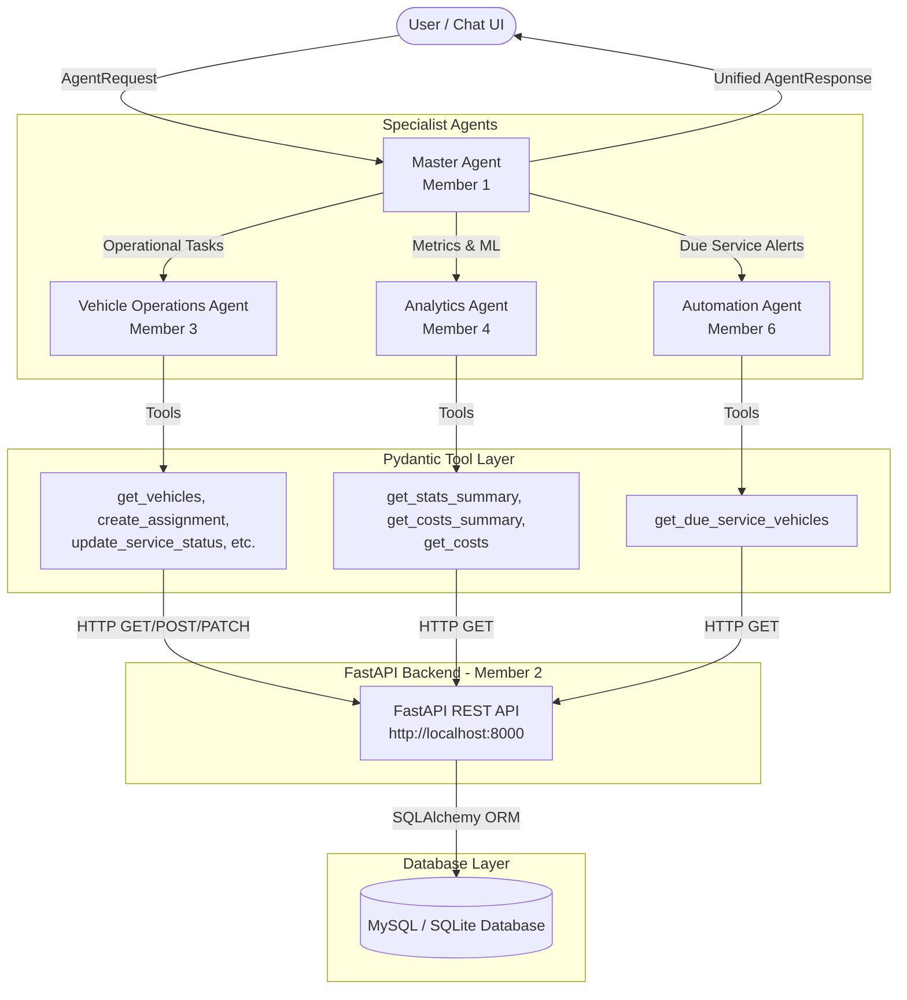

# Multi-Agent Architecture for Vehicle Service Management

This document explains the architecture of the multi-agent assistant built on top of the Vehicle Service Management FastAPI backend.

---

## 1. System Overview & Mermaid Diagram

The multi-agent system follows a strict hierarchical delegation pattern. Users interact exclusively with the **Master Agent**. The Master Agent routes requests to specialist agents, which call tools wrapping the backend REST API. The API communicates with the database. **Agents never connect directly to MySQL or SQLite.**



---

## 2. Agent Responsibilities & Boundaries

### 1. Master Agent (Member 1 - Architect)
- **Why it exists**: Provides a single unified front door for the user. It classifies intent, resolves ambiguous questions, decomposes multi-agent requests, and merges specialist responses into one clear answer.
- **Allowed to do**: Classify user intent, route to specialist agents, ask clarifying questions, aggregate specialist answers into `AgentResponse`.
- **NOT allowed to do**:
  - Never calls backend API endpoints directly.
  - Never connects to the database.
  - Never invents data or bypasses write confirmation.

---

### 2. Vehicle Operations Agent (Member 3)
- **Why it exists**: Owns the daily fleet operations: vehicles, drivers, assignments, service bookings, status progressions, and cost entries.
- **Allowed to do**:
  - Read fleet data (`get_vehicles`, `get_available_vehicles`, `get_vehicle_by_id`, `get_vehicle_history`).
  - Read driver data (`get_drivers`, `get_driver_by_id`).
  - Read assignments and service records (`get_assignments`, `get_services`, `get_service_by_id`).
  - Prepare and execute write operations (`create_assignment`, `release_assignment`, `create_service`, `update_service_status`, `create_cost`) strictly after explicit user confirmation.
- **NOT allowed to do**:
  - Never executes write actions without confirmation (`confirmed=True`).
  - Never calls DELETE endpoints.
  - Never violates business constraints (e.g., assigning an unavailable vehicle or skipping service status transitions).

---

### 3. Analytics Agent (Member 4)
- **Why it exists**: Serves as the read-only intelligence and financial reporting hub for fleet operations. (Future home of Member 4's predictive ML models).
- **Allowed to do**:
  - Retrieve aggregated fleet statistics (`get_stats_summary`).
  - Retrieve expense summaries by vehicle, month, and grand total (`get_costs_summary`).
  - Inspect individual cost logs (`get_costs`).
- **NOT allowed to do**:
  - Strictly read-only: never modifies database records.
  - Never assigns vehicles, creates service records, or changes statuses.
  - Never invents metric values or financial numbers.

---

### 4. Automation Agent (Member 6)
- **Why it exists**: Proactively tracks upcoming maintenance deadlines, finds overdue vehicles or vehicles due within 7 days, and triggers notification workflows.
- **Allowed to do**:
  - Query vehicles due for service (`get_due_service_vehicles`).
  - Calculate days overdue or days until scheduled service.
  - Trigger maintenance alerts and notifications for fleet managers.
- **NOT allowed to do**:
  - Strictly read-only on fleet data.
  - Never creates service bookings or assigns drivers directly (hands off booking tasks to the Vehicle Operations Agent).

---

## 3. Worked Step-by-Step Traces

### Trace A: Read-Only Query ("Which vehicles are due for service?")
1. **User Input**:
   ```json
   {
     "session_id": "sess-01",
     "message": "Which vehicles are due for service?",
     "context": {}
   }
   ```
2. **Master Agent Routing**:
   - `router_node` receives message and runs `classify_intent`.
   - Pattern `"due for service"` matches `Intent.AUTOMATION`.
   - Router selects target agent: `["automation_agent"]`.
3. **Automation Agent Execution**:
   - Automation Agent invokes `get_due_service_vehicles()`.
   - Tool layer checks `USE_MOCK_TOOLS`.
     - In mock mode: queries in-memory seed store where `next_service_date <= today + 7 days`.
     - In live mode: sends `GET /vehicles/due-service` to `http://localhost:8000`.
   - Returns 3 vehicles:
     * ID 1 (`KAA-1001`): Overdue by 3 days.
     * ID 2 (`KBB-2002`): Due in 2 days.
     * ID 3 (`KCC-3003`): Due in 5 days.
4. **Master Agent Aggregation**:
   - Formats a clear bulleted maintenance alert.
   - Sets `status="success"`, `agent_used="automation_agent"`, `tools_called=["get_due_service_vehicles"]`.
5. **Final Output to User**:
   ```json
   {
     "status": "success",
     "answer": "Maintenance Alert: Found 3 vehicle(s) requiring attention:\n- KAA-1001 (Toyota Corolla) - OVERDUE by 3 days (due: 2026-10-13)\n- KBB-2002 (Ford Transit) - Due in 2 days (due: 2026-10-18)\n- KCC-3003 (Isuzu NPR) - Due in 5 days (due: 2026-10-21)",
     "data": [ ... ],
     "agent_used": "automation_agent",
     "tools_called": ["get_due_service_vehicles"],
     "error": null
   }
   ```

---

### Trace B: Write Action with Safety Confirmation ("Assign vehicle 11 to driver 1")

#### Turn 1: Write Request (Pre-check & Confirmation)
1. **User Input**:
   ```json
   {
     "session_id": "sess-02",
     "message": "Assign vehicle 11 to driver 1",
     "context": {"confirmed": false}
   }
   ```
2. **Master Agent Routing**:
   - Router detects `Intent.VEHICLE_OPERATIONS` -> targets `vehicle_agent`.
3. **Vehicle Agent Pre-validation**:
   - Calls `create_assignment(vehicle_id=11, driver_id=1, confirmed=False)`.
   - Pre-validation checks:
     * Does vehicle 11 exist? Yes (Toyota HiAce).
     * Is vehicle 11 available? Yes (`status == "available"`).
     * Does driver 1 exist? Yes (John Doe).
   - Because `confirmed=False`, the tool does NOT modify database state.
   - It constructs a `ConfirmationRequiredOutput` containing:
     * Action: `create_assignment`
     * Summary: `"Assign vehicle 11 (Toyota HiAce, plate KBZ-4567) to driver 1 (John Doe). Vehicle status will change from 'available' to 'assigned'."`
4. **Response Returned to User**:
   ```json
   {
     "status": "needs_confirmation",
     "answer": "You are about to assign vehicle 11 to driver 1. Assign vehicle 11 (Toyota HiAce, plate KBZ-4567) to driver 1 (John Doe). Vehicle status will change from 'available' to 'assigned'. Would you like to proceed?",
     "data": {
       "action": "create_assignment",
       "summary": "Assign vehicle 11 (Toyota HiAce, plate KBZ-4567) to driver 1 (John Doe). Vehicle status will change from 'available' to 'assigned'.",
       "parameters": {"vehicle_id": 11, "driver_id": 1},
       "precheck_passed": true
     },
     "agent_used": "vehicle_agent",
     "tools_called": ["create_assignment"],
     "error": null
   }
   ```

#### Turn 2: User Confirms Action
1. **User Confirmation Input**:
   ```json
   {
     "session_id": "sess-02",
     "message": "Yes, proceed with assigning vehicle 11 to driver 1",
     "context": {
       "confirmed": true,
       "action": "create_assignment",
       "vehicle_id": 11,
       "driver_id": 1
     }
   }
   ```
2. **Vehicle Agent Execution**:
   - Sees `confirmed=True` in context.
   - Calls `create_assignment(vehicle_id=11, driver_id=1, confirmed=True)`.
   - Live API call: `POST /assignments` with `{"vehicle_id": 11, "driver_id": 1}`.
   - Backend creates Assignment #4 and updates Vehicle 11 status to `"assigned"`.
3. **Final Response**:
   ```json
   {
     "status": "success",
     "answer": "Vehicle 11 successfully assigned to driver 1 (Assignment #4).",
     "data": {
       "id": 4,
       "vehicle_id": 11,
       "driver_id": 1,
       "assigned_at": "2026-10-16T08:41:00",
       "released_at": null,
       "is_active": true
     },
     "agent_used": "vehicle_agent",
     "tools_called": ["create_assignment"],
     "error": null
   }
   ```
